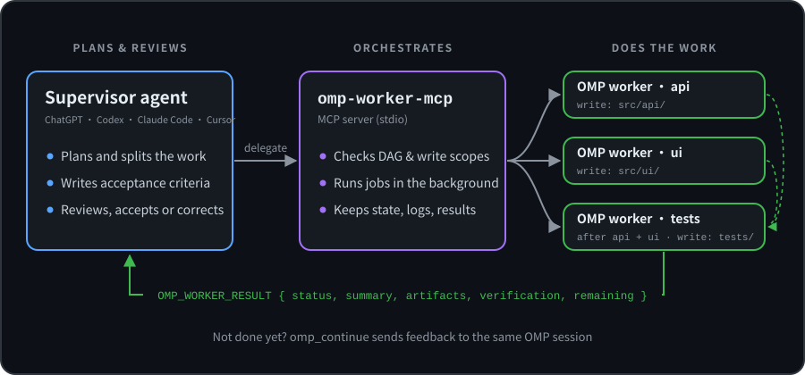
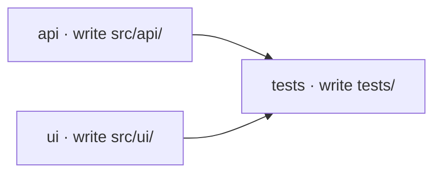

<div align="center">

# omp-worker-mcp

**Let your main AI agent plan and review — and hand the hands-on coding to local [Oh My Pi](https://github.com/can1357/oh-my-pi) workers.**

An MCP server that turns ChatGPT, Codex, Claude Code, Cursor and other MCP clients into a *supervisor*,<br />
and Oh My Pi (OMP) on your own machine into its background *workforce*.

[](https://www.npmjs.com/package/omp-worker-mcp)
[](https://github.com/divenire990/omp-worker-mcp/actions/workflows/ci.yml)
[](package.json)
[](server.json)
[](LICENSE)

English · [简体中文](README.zh-CN.md) · [Documentation](docs/README.md)

<br />



[Quick start](#quick-start) · [Usage](#usage) · [Tools](#tools) · [Configuration](#configuration) · [Safety model](#safety-model) · [FAQ](#faq)

</div>

---

## What it does

Most coding agents do everything in one place: read the code, plan, edit, run tests, fix — all inside one conversation and one model's budget. `omp-worker-mcp` splits that work into two roles:

| Role | Who | Responsibility |
| :--- | :--- | :--- |
| **Supervisor** | The agent you talk to: ChatGPT, Codex, Claude Code, Cursor… | Understands the request, splits the work, writes acceptance criteria, reviews the results |
| **Worker** | The OMP CLI on your machine, using the model you picked in `omp setup` | Reads files, edits code, runs shell commands and tests, reports back |

`omp-worker-mcp` is the bridge between them. It gives the supervisor a small set of MCP tools, starts OMP in the background, keeps every job on disk, and returns a short structured report instead of a wall of logs.

**Highlights**

- **One task or a whole plan** — `omp_run_compact` delegates a single task; `omp_run_batch_compact` runs up to 50 tasks as a dependency graph (DAG), up to 10 at a time.
- **Declared write-scope validation** — parallel write tasks in a batch must declare the paths they own; overlapping declared scopes and dependency cycles are rejected before any worker starts (a scheduling check and prompt constraint, not an OS filesystem lock).
- **Results you can review** — every worker finishes with an `OMP_WORKER_RESULT` envelope: status, summary, changed files, verification evidence and remaining items.
- **Correct instead of restart** — `omp_continue` sends feedback to the *same* OMP session, so the worker keeps its context.
- **Persistent jobs** — job records, logs and results live on disk and can still be read after the MCP server restarts.
- **Works from ChatGPT on the web** — through OpenAI's Secure MCP Tunnel: no inbound port, plus an allowlist (`OMP_WORKER_ALLOWED_ROOTS`, available since `0.2.0`; npm `0.1.1` lacks this feature) for the directories jobs may run in.

## When to use it

**A good fit when**

- you want a strong model to make the decisions while a faster or cheaper model does the typing;
- the task is big enough to hand off: a feature, a bug fix with tests, a multi-module refactor, a long read-only investigation;
- you want several parts of a repo worked on in parallel without agents overwriting each other;
- you think with ChatGPT and want it to act on files on your own machine.

**Probably not worth it when**

- the change is one line or the question is quick — the supervisor's own tools are faster;
- you need a real OS-level sandbox. This project controls *where* jobs start and *what* they are told to touch, not what OMP is technically able to do (see [Safety model](#safety-model)).

---

## Quick start

**You need:** Node.js ≥ 22 · [Oh My Pi](https://github.com/can1357/oh-my-pi) installed · an MCP client (Codex, Claude Code, Cursor, ChatGPT, …).

### 1. Install and set up OMP

Install OMP by following [its official instructions](https://github.com/can1357/oh-my-pi), then:

```bash
omp --version   # confirm the CLI is on your PATH
omp setup       # sign in and choose the default model
```

The default model you pick here is the model every worker will use. (Advanced: set `modelRoles.default: <provider>/<model>` in `~/.omp/agent/config.yml`.)

> If `omp` is not on your `PATH`, set `OMP_WORKER_OMP_COMMAND` to the full path of the executable in the MCP config below.

### 2. Register the MCP server in your client

There is nothing to install globally — the client runs the published package with `npx -y omp-worker-mcp`. Pick your client:

<details open>
<summary><b>Codex</b> — the author's daily setup</summary>

Edit `~/.codex/config.toml` (Windows: `C:\Users\<you>\.codex\config.toml`):

```toml
[mcp_servers.omp-worker]
command = "npx"
args = ["-y", "omp-worker-mcp"]

[mcp_servers.omp-worker.env]
OMP_WORKER_OMP_COMMAND = "omp"

# Optional (Codex Code Mode only): let Codex call omp-worker tools directly
# without code-mode wrapping. Per the current Codex config reference, merge into
# your existing [features.code_mode] table (do not create a duplicate table header)
# and append "mcp__omp_worker" while preserving any other list entries:
[features.code_mode]
direct_only_tool_namespaces = ["mcp__omp_worker"]
```

*(If `[features.code_mode]` already exists in your `config.toml`, merge into that table and append `"mcp__omp_worker"` to `direct_only_tool_namespaces` rather than duplicating the table or overwriting existing entries. Legacy Codex builds used a top-level `direct_only_tool_namespaces = ["mcp__omp_worker"]` key before any `[table]` header. Neither setting is required to register the MCP server; see [Codex direct namespace setup](docs/author-workflow.md#codex-direct-namespace-setup) and the [official Codex Config Reference](https://learn.chatgpt.com/docs/config-file/config-reference).)*

</details>

<details>
<summary><b>ChatGPT (web)</b> — via Secure MCP Tunnel</summary>

> **Version requirement (`>= 0.2.0`):** `OMP_WORKER_ALLOWED_ROOTS` is available since `omp-worker-mcp` `0.2.0` (historical npm `0.1.1` lacks this feature and does not enforce `OMP_WORKER_ALLOWED_ROOTS`). Confirm `npx -y omp-worker-mcp@latest --version` reports `0.2.0` or newer before exposing local execution remotely.

Run the server locally behind OpenAI's `tunnel-client`; your machine only makes outbound connections.

```bash
export OMP_WORKER_OMP_COMMAND=omp
export OMP_WORKER_ALLOWED_ROOTS='["/Users/you/Projects"]'   # strongly recommended for remote access (available since 0.2.0; 0.1.1 lacks this feature)
export CONTROL_PLANE_API_KEY='<runtime-api-key>'

tunnel-client init \
  --sample sample_mcp_stdio_local \
  --profile omp-worker \
  --tunnel-id <your-tunnel-id> \
  --mcp-command "npx -y omp-worker-mcp"

tunnel-client doctor --profile omp-worker --explain
tunnel-client run --profile omp-worker
```

Windows PowerShell commands, `0.1.1` upgrade / local-build notes, managed runtime alternatives (`tunnel-client runtimes connect`), permission requirements and the full trust boundary: [ChatGPT Secure MCP Tunnel guide](docs/chatgpt-secure-tunnel.md).
</details>

<details>
<summary><b>Claude Code</b></summary>

```bash
claude mcp add omp-worker --scope user --env OMP_WORKER_OMP_COMMAND=omp -- npx -y omp-worker-mcp
```

Use `--scope project` to register it for the current project only. On Windows `cmd.exe`, if `npx` fails to resolve, use `cmd /c npx`.

</details>

<details>
<summary><b>Cursor · VS Code / Copilot · Windsurf · Continue · any JSON-config client</b></summary>

```json
{
  "mcpServers": {
    "omp-worker": {
      "command": "npx",
      "args": ["-y", "omp-worker-mcp"],
      "env": {
        "OMP_WORKER_OMP_COMMAND": "omp"
      }
    }
  }
}
```

File locations and client-specific notes: [Client configurations](docs/client-configurations.md).

</details>

Restart the client after changing its config.

### 3. Tell your agent when to delegate

Registering the server makes the tools *available*; it does not make the agent *choose* them. Add a short policy to your project's instruction file — `AGENTS.md` (Codex), `CLAUDE.md` (Claude Code), `.cursorrules` / `.github/copilot-instructions.md` (others) — or to ChatGPT's project instructions:

```markdown
## Delegation policy (omp-worker-mcp)
- Quick questions, single-file edits, design discussion: do it yourself.
- Substantive single tasks (feature, bug fix, refactor, long investigation): inspect briefly,
  then delegate with `omp_run_compact`, giving a clear `goal` and `acceptance` criteria.
- Multi-part work: use `omp_run_batch_compact`. Parallel write tasks need disjoint `ownership`;
  tasks touching the same files must be ordered with `depends_on`.
- Review every result. If acceptance is not met, use `omp_continue` with specific feedback.
- Never delegate `git push`, publishing, deployments or secret changes — confirm those with the user.
```

A fuller template: [Author workflow → Policy template](docs/author-workflow.md#policy-template).

### 4. Run your first task

Start with something read-only:

```text
Use omp-worker-mcp to do a read-only inspection of this workspace: summarize the
project structure and dependencies. Do not modify any files.
```

**What you should see:** the agent calls `omp_run_compact`, OMP works in the background, and a short summary comes back with no files changed. If the job runs longer than the wait window (60 s by default), the call returns a `job_id` with status `running` and the agent keeps going with `omp_wait` — that is normal.

---

## Usage

Once the policy is in place you can just describe the outcome you want. The examples below show what the supervisor sends under the hood.

### A single task

> *"Add exponential backoff to the HTTP client in `src/net/`, cover it with unit tests, and make sure `npm test` passes."*

```jsonc
// omp_run_compact
{
  "cwd": "/path/to/repo",
  "goal": "Add exponential backoff (max 5 retries) to src/net/client.ts for 5xx and network errors.",
  "acceptance": [
    "Unit tests cover the retry and give-up paths",
    "npm test passes"
  ],
  "timeout_minutes": 30
}
```

What comes back is compact (abridged example):

```jsonc
{
  "job_id": "job-…",
  "status": "completed",
  "attempt": 1,
  "max_attempts": 3,
  "session_id": "sess-…",
  "summary": "Added retry with exponential backoff to the HTTP client.",
  "artifacts": [
    { "path": "src/net/client.ts", "description": "retry loop + backoff helper" },
    { "path": "test/net/client.test.ts", "description": "retry / give-up tests" }
  ],
  "verification": ["npm test: all tests passed"],
  "remaining": [],
  "details_path": "…/jobs/job-…/job.json"
}
```

### Several tasks as a DAG

> *"Add a `/health` endpoint to the API and a status badge to the UI in parallel, then add an integration test that covers both."*



```jsonc
// omp_run_batch_compact
{
  "cwd": "/path/to/repo",
  "max_parallel": 2,
  "tasks": [
    { "id": "api",   "goal": "Add GET /health returning build info.", "access": "write", "ownership": ["src/api/"] },
    { "id": "ui",    "goal": "Show a status badge fed by /health.",   "access": "write", "ownership": ["src/ui/"] },
    { "id": "tests", "goal": "Add an integration test for /health and the badge.",
      "depends_on": ["api", "ui"], "access": "write", "ownership": ["tests/"],
      "acceptance": ["npm test passes"] }
  ]
}
```

Rules worth knowing:

- `write` tasks must list the paths they own in `ownership` (relative to `cwd`); `read_only` tasks list none.
- Two tasks that may run at the same time cannot own overlapping paths — order them with `depends_on` instead.
- `max_parallel` is 1–10 (default 4); the whole group has a deadline (`group_timeout_minutes`, default 60).
- If the group is still running when the wait window ends, you get a `group_id`; continue with `omp_wait_group`.

### Supervising a job

| Situation | Tool |
| :--- | :--- |
| Still running | `omp_wait` / `omp_wait_group` |
| Need logs, attempts or the full final answer | `omp_result` |
| Result doesn't meet acceptance | `omp_continue` with concrete feedback (counts toward `max_attempts`, default 3) |
| Wrong direction, stop it | `omp_cancel` / `omp_cancel_group` |

---

## Tools

| Tool | Kind | What it does |
| :--- | :--- | :--- |
| `omp_run_compact` | **Recommended** | Start one task and wait up to `wait_seconds` (≤ 60) for a compact result |
| `omp_run_batch_compact` | **Recommended** | Validate and run a DAG of up to 50 tasks; wait up to `wait_seconds` (≤ 240) |
| `omp_delegate` | Low-level | Start one task and return a `job_id` immediately |
| `omp_wait` | Low-level | Wait for a job to finish |
| `omp_wait_group` | Low-level | Wait for a batch group to finish |
| `omp_result` | Inspect | Full status, attempts, `attempt-NN.stdout.jsonl` / `attempt-NN.stderr.log` paths, final response |
| `omp_continue` | Supervise | Send feedback to the same OMP session for another attempt |
| `omp_cancel` | Control | Stop a job and its process tree |
| `omp_cancel_group` | Control | Stop every pending and running task in a group |

Full parameters and limits: [Tool reference](docs/tool-reference.md).

---

## Configuration

Everything is configured through environment variables, set in the client's MCP config (`env`) or in the shell that launches the server.

| Variable | Default | Purpose |
| :--- | :--- | :--- |
| `OMP_WORKER_OMP_COMMAND` | `omp` | OMP executable name or full path |
| `OMP_WORKER_ALLOWED_ROOTS` | *(unset = no restriction)* | JSON array of absolute directories that jobs must run inside. **Set this for any remote use.** *(Available since `0.2.0`; npm `0.1.1` lacks this feature.)* |
| `OMP_WORKER_STATE_DIR` | `~/.codex/state/omp-worker` | Where job state, prompts and logs are stored (the default path is used even if you don't use Codex) |
| `OMP_WORKER_RETENTION_TTL_SECONDS` | *(unset = keep forever)* | Delete finished records older than N seconds |
| `OMP_WORKER_RETENTION_MAX_BYTES` | *(unset = no limit)* | Delete the oldest finished records once the store exceeds N bytes |

All variables, the on-disk layout and restart behaviour: [Operations](docs/operations.md) · [`.env.example`](.env.example).

---

## Safety model

**What `omp-worker-mcp` enforces**

- With `OMP_WORKER_ALLOWED_ROOTS` set *(available since `0.2.0`; npm `0.1.1` lacks this feature)*, a job's `cwd` must resolve (via `realpath`) inside an approved root. Sibling-prefix tricks and symlink/junction escapes are rejected before OMP starts; a present-but-invalid value fails closed.
- In a batch, parallel `write` tasks must have disjoint `ownership`, and the graph must be acyclic — checked before any worker is spawned.
- Ownership and read-only intent are passed to each worker as explicit constraints.

**What it does not do**

- It is **not a sandbox**. OMP and anything it runs have the same permissions as the user account that started the server. Ownership is a scheduling check plus an instruction to the worker, not a filesystem lock.
- It does not decide what is safe to run. Keep `git push`, publishing, deployments and secret changes with you and the supervisor.

For remote access (e.g. ChatGPT via Secure MCP Tunnel), always set `OMP_WORKER_ALLOWED_ROOTS`, and consider a dedicated low-privilege account, a container or a VM. To report a vulnerability, see [SECURITY.md](SECURITY.md).

---

## Platform support

| Platform | Status |
| :--- | :--- |
| Windows | ✅ Verified end-to-end with the real OMP CLI and in CI (`windows-latest`) |
| macOS | 🟡 Full test suite runs in CI (`macos-latest`, with a fake OMP); not yet verified end-to-end with the real OMP CLI |
| Linux | 🟡 Full test suite runs in CI (`ubuntu-latest`, with a fake OMP); not yet verified end-to-end with the real OMP CLI |

| Client | Status |
| :--- | :--- |
| Codex | ✅ Used daily by the author |
| ChatGPT web (Secure MCP Tunnel) | 📄 Documented workflow — see the [guide](docs/chatgpt-secure-tunnel.md) |
| Claude Code, Cursor, VS Code / Copilot, Windsurf, Continue | 📄 Documented configurations, not integration-tested in CI |
| Cloud / remote agent hosts | ⚠️ Only if they provide Node.js ≥ 22, OMP on `PATH`, a writable workspace and process spawning |

Linux reports and client configs that you have verified are very welcome — see [Contributing](CONTRIBUTING.md).

---

## FAQ

<details>
<summary><b>The agent ignores the tools and does everything itself.</b></summary>

Tools being available doesn't mean they get chosen. Add the delegation policy from [step 3](#3-tell-your-agent-when-to-delegate), or name the server explicitly in your prompt ("use omp-worker-mcp to…"). On Codex with Code Mode enabled, you can also optionally configure `features.code_mode.direct_only_tool_namespaces`.
</details>

<details>
<summary><b>The job fails right away with "command not found" / <code>ENOENT</code>.</b></summary>

The MCP server can't find OMP. Set `OMP_WORKER_OMP_COMMAND` to the full path of the executable — GUI clients often start with a shorter `PATH` than your terminal.
</details>

<details>
<summary><b>I got a <code>job_id</code> with status <code>running</code> instead of a result.</b></summary>

Expected for longer tasks: the call only waits up to `wait_seconds`. The job keeps running in the background; call `omp_wait` (or `omp_wait_group`) to keep waiting.
</details>

<details>
<summary><b>Which model do the workers use?</b></summary>

OMP's default model — the one chosen in `omp setup` (or `modelRoles.default` in `~/.omp/agent/config.yml`). The supervisor's model is whatever your client uses. That's the point: they can be different.
</details>

<details>
<summary><b>"outside OMP_WORKER_ALLOWED_ROOTS" error.</b></summary>

The task's `cwd` is not inside any approved root. This is the allowlist working; add the directory to `OMP_WORKER_ALLOWED_ROOTS` if it should be allowed (note: `OMP_WORKER_ALLOWED_ROOTS` is available since `0.2.0`; npm `0.1.1` lacks this feature).
</details>

<details>
<summary><b>"Concurrent write ownership conflict" error.</b></summary>

Two tasks that could run at the same time own overlapping paths. Give them separate `ownership` scopes, or add `depends_on` so one runs after the other.
</details>

<details>
<summary><b>How is this different from the subagents built into my client?</b></summary>

The worker is a separate agent (OMP) with its own model and provider, runs in the background across conversation turns, keeps its state on disk, and can be driven by any MCP client — including ChatGPT on the web. Batches add dependency ordering and write-scope checks on top.
</details>

---

## Documentation

| Guide | Read it when you want to… |
| :--- | :--- |
| [Author workflow](docs/author-workflow.md) | Set up the delegation policy and understand the supervise → review → correct loop |
| [Client configurations](docs/client-configurations.md) | Configure Codex, Claude Code, Cursor, VS Code, Windsurf or Continue |
| [ChatGPT Secure MCP Tunnel](docs/chatgpt-secure-tunnel.md) | Drive local OMP from ChatGPT on the web |
| [Tool reference](docs/tool-reference.md) | See every tool, parameter and the result envelope |
| [Operations](docs/operations.md) | Tune environment variables, storage, retention and restarts |
| [Benchmark protocol](benchmarks/README.md) | Compare direct execution with supervisor–worker delegation |
| [Registry publishing](docs/registry-publishing.md) | Release to npm and the Official MCP Registry (maintainers) |

[COMPATIBILITY.md](COMPATIBILITY.md) defines the public contract and versioning policy; [CHANGELOG.md](CHANGELOG.md) lists releases.

## Contributing

Issues and pull requests are welcome — especially Linux verification and tested client configs. Start with [CONTRIBUTING.md](CONTRIBUTING.md). To build from source:

```bash
git clone https://github.com/divenire990/omp-worker-mcp.git
cd omp-worker-mcp
npm ci
npm test        # builds, then runs the test suite against a fake OMP
```

## Acknowledgements

Built on the [Model Context Protocol TypeScript SDK](https://github.com/modelcontextprotocol/typescript-sdk) and designed around [Oh My Pi](https://github.com/can1357/oh-my-pi) (MIT). OMP is not bundled and must be installed separately. This project is independent and not affiliated with OMP, OpenAI or Anthropic.

## License

[MIT](LICENSE)
