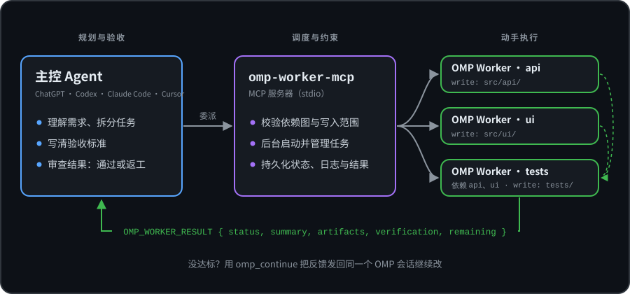
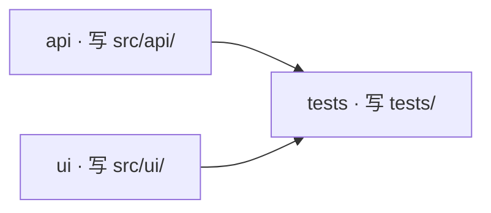

<div align="center">

# omp-worker-mcp

**让主力 AI 负责规划和验收，把动手写代码的活交给本机的 [Oh My Pi](https://github.com/can1357/oh-my-pi) Worker。**

一个 MCP 服务器：让 ChatGPT、Codex、Claude Code、Cursor 等 MCP 客户端当“主控”，<br />
让你电脑上的 Oh My Pi（OMP）当它在后台干活的“执行者”。

[](https://www.npmjs.com/package/omp-worker-mcp)
[](https://github.com/divenire990/omp-worker-mcp/actions/workflows/ci.yml)
[](package.json)
[](server.json)
[](LICENSE)

[English](README.md) · 简体中文 · [文档中心](docs/README.zh-CN.md)

<br />



[快速开始](#快速开始) · [使用示例](#使用示例) · [工具一览](#工具一览) · [配置](#配置) · [安全模型](#安全模型) · [常见问题](#常见问题)

</div>

---

## 它解决什么问题

大多数编程 Agent 什么都自己干：读代码、做计划、改文件、跑测试、修 bug，全挤在同一个对话、同一个模型的额度里。`omp-worker-mcp` 把这件事拆成两个角色：

| 角色 | 由谁担任 | 负责什么 |
| :--- | :--- | :--- |
| **主控（Supervisor）** | 你正在对话的 Agent：ChatGPT、Codex、Claude Code、Cursor… | 理解需求、拆分任务、写验收标准、审查结果 |
| **执行者（Worker）** | 你本机的 OMP CLI，使用你在 `omp setup` 里选的模型 | 读文件、改代码、跑命令和测试、汇报结果 |

`omp-worker-mcp` 就是两者之间的桥：它给主控提供一组 MCP 工具，在后台启动 OMP，把每个任务记录在磁盘上，最后交回一份简短的结构化报告，而不是一大段日志。

**主要特点**

- **单个任务或整套计划都行**：`omp_run_compact` 委派单个任务；`omp_run_batch_compact` 把最多 50 个任务按依赖关系（DAG）调度，最多 10 个同时跑。
- **声明式写入范围校验**：批量并行的写任务必须声明自己负责的路径，声明范围重叠或依赖成环会在任何 Worker 启动前被拒绝（属于调度前检查与提示词约束，而非系统级文件锁）。
- **结果可审查**：每个 Worker 都以 `OMP_WORKER_RESULT` 收尾：状态、摘要、改了哪些文件、验证证据、遗留事项。
- **返工不用从头来**：`omp_continue` 把反馈发回**同一个** OMP 会话，Worker 保留之前的上下文。
- **任务记录持久化**：任务元数据、日志和结果都存在磁盘上，MCP 服务器重启后依然可以查询。
- **网页版 ChatGPT 也能用**：通过 OpenAI Secure MCP Tunnel 连接，本机不开放入站端口，并可通过 `OMP_WORKER_ALLOWED_ROOTS` 限制任务只能在指定目录中运行（该特性位于尚未发布至 npm 的 `master` 源码中，请通过 commit SHA 标识；已发布的 npm `0.1.1` 早于该特性）。

## 适合什么场景

**适合：**

- 想让强模型做决策，让更快或更便宜的模型去写代码；
- 任务够大、值得委派：一个功能、带测试的 bug 修复、跨模块重构、较长的只读调研；
- 想让仓库里不同部分并行推进，又不想多个 Agent 互相覆盖；
- 习惯用 ChatGPT 思考，希望它能直接操作你电脑上的文件。

**不太值得：**

- 只改一行或者问个小问题——主控自己动手更快；
- 你需要真正的系统级沙箱。本项目控制的是任务**在哪里启动**、**被告知能碰什么**，而不是 OMP 在技术上能做什么（见[安全模型](#安全模型)）。

---

## 快速开始

**前置条件：** Node.js ≥ 22 · 已安装 [Oh My Pi](https://github.com/can1357/oh-my-pi) · 一个 MCP 客户端（Codex、Claude Code、Cursor、ChatGPT 等）。

### 1. 安装并配置 OMP

按 [OMP 官方说明](https://github.com/can1357/oh-my-pi) 安装，然后执行：

```bash
omp --version   # 确认命令在 PATH 中
omp setup       # 登录并选择默认模型
```

这里选的默认模型，就是所有 Worker 干活时使用的模型。（进阶：也可以在 `~/.omp/agent/config.yml` 中设置 `modelRoles.default: <provider>/<model>`。）

> 如果 `omp` 不在 `PATH` 中，请在下面的 MCP 配置里把 `OMP_WORKER_OMP_COMMAND` 设为可执行文件的完整路径。

### 2. 在客户端中注册 MCP 服务器

不需要全局安装——客户端会用 `npx -y omp-worker-mcp` 直接运行已发布的 npm 包。选择你的客户端：

<details open>
<summary><b>Codex</b>（作者日常使用的配置）</summary>

编辑 `~/.codex/config.toml`（Windows：`C:\Users\<你>\.codex\config.toml`）：

```toml
[mcp_servers.omp-worker]
command = "npx"
args = ["-y", "omp-worker-mcp"]

[mcp_servers.omp-worker.env]
OMP_WORKER_OMP_COMMAND = "omp"

# 可选（仅用于 Codex Code Mode）：让 Codex 直接调用 omp-worker 工具而不经过 code-mode 包装。
# 按当前官方 Codex 配置参考，请合并进已有的 [features.code_mode] 表（切勿重复声明同名表头），
# 并将 "mcp__omp_worker" 追加到列表中（保留你已有的其他条目，避免覆盖）：
[features.code_mode]
direct_only_tool_namespaces = ["mcp__omp_worker"]
```

*（如果 `config.toml` 中已有 `[features.code_mode]` 表，请直接合并进该表并在 `direct_only_tool_namespaces` 列表中追加 `"mcp__omp_worker"`，避免产生重复表头或覆盖已有列表项。旧版 Codex 曾使用写在所有 `[表头]` 之前的顶层键 `direct_only_tool_namespaces = ["mcp__omp_worker"]`。无论新旧写法均为可选偏好，并非注册 MCP 服务所必需；详见 [Codex 专属直接命名空间配置](docs/author-workflow.zh-CN.md#codex-专属直接命名空间配置) 与 [Codex 官方配置参考](https://learn.chatgpt.com/docs/config-file/config-reference)。）*

</details>

<details>
<summary><b>ChatGPT（网页版）</b>：通过 Secure MCP Tunnel</summary>

> **版本边界提示（未发布的 `master` 源码 vs. npm `0.1.1`）：** `OMP_WORKER_ALLOWED_ROOTS` 位于尚未发布至 npm 的 `master` 源码中（请通过 commit SHA 标识源码版本，其 `package.json` 与 CLI 仍显示 `0.1.1`）；已发布的 npm `0.1.1` 早于该特性。远程暴露本机执行能力前，请从 `master` 源码构建并将 `--mcp-command` 指向 `node <仓库路径>/dist/index.js`。

在本机通过 OpenAI 的 `tunnel-client` 运行服务器，你的电脑只发起出站连接。

```bash
export OMP_WORKER_OMP_COMMAND=omp
export OMP_WORKER_ALLOWED_ROOTS='["/Users/you/Projects"]'   # 远程访问时强烈建议设置（位于未发布的 master 源码；npm 0.1.1 早于该特性）
export CONTROL_PLANE_API_KEY='<runtime-api-key>'

tunnel-client init \
  --sample sample_mcp_stdio_local \
  --profile omp-worker \
  --tunnel-id <your-tunnel-id> \
  --mcp-command "node /abs/path/to/omp-worker-mcp/dist/index.js"

tunnel-client doctor --profile omp-worker --explain
tunnel-client run --profile omp-worker
```

Windows PowerShell 写法、源码构建步骤、`tunnel-client runtimes connect` 托管模式、权限要求和完整信任边界见 [ChatGPT Secure MCP Tunnel 指南](docs/chatgpt-secure-tunnel.zh-CN.md)。
</details>

<details>
<summary><b>Claude Code</b></summary>

```bash
claude mcp add omp-worker --scope user --env OMP_WORKER_OMP_COMMAND=omp -- npx -y omp-worker-mcp
```

只想在当前项目使用，就把 `--scope user` 换成 `--scope project`。Windows `cmd.exe` 下如果 `npx` 找不到，改用 `cmd /c npx`。

</details>

<details>
<summary><b>Cursor · VS Code / Copilot · Windsurf · Continue · 其他 JSON 配置的客户端</b></summary>

```json
{
  "mcpServers": {
    "omp-worker": {
      "command": "npx",
      "args": ["-y", "omp-worker-mcp"],
      "env": {
        "OMP_WORKER_OMP_COMMAND": "omp"
      }
    }
  }
}
```

各客户端的配置文件位置和注意事项见 [客户端接入与配置指南](docs/client-configurations.zh-CN.md)。

</details>

改完配置后重启客户端。

### 3. 告诉 Agent 什么时候该委派

注册服务器只是让工具**可用**，并不代表 Agent 会**主动选用**。在项目的指令文件里加一段简短规则——`AGENTS.md`（Codex）、`CLAUDE.md`（Claude Code）、`.cursorrules` / `.github/copilot-instructions.md`（其他客户端）——或者写进 ChatGPT 项目的说明里：

```markdown
## 委派规则（omp-worker-mcp）
- 简单问答、单文件小改、方案讨论：自己做。
- 有分量的单个任务（新功能、修 bug、重构、较长的调研）：先简单看一下代码，
  再用 `omp_run_compact` 委派，写清楚 `goal` 和 `acceptance`。
- 多个部分的工作：用 `omp_run_batch_compact`。并行写任务的 `ownership` 不能重叠；
  会改到同一批文件的任务要用 `depends_on` 排先后。
- 每个结果都要审查；没达到验收标准，就用 `omp_continue` 给出具体反馈。
- `git push`、发布、部署、修改密钥等操作不要委派，必须先和用户确认。
```

更完整的模板：[作者工作流 → 策略模板内容](docs/author-workflow.zh-CN.md#策略模板内容)。

### 4. 跑第一个任务

先从只读任务开始：

```text
请使用 omp-worker-mcp 对当前工作区做一次只读检查，总结项目结构和依赖情况。不要修改任何文件。
```

**正常情况下你会看到：** Agent 调用 `omp_run_compact`，OMP 在后台工作，然后返回一段简短总结，没有任何文件被修改。如果任务运行时间超过等待窗口（默认 60 秒），调用会先返回 `job_id` 和 `running` 状态，Agent 接着用 `omp_wait` 等待——这是正常现象。

---

## 使用示例

配好委派规则后，你只要描述想要的结果即可。下面展示的是主控在背后实际发送的内容。

### 单个任务

> “给 `src/net/` 里的 HTTP 客户端加上指数退避重试，写单元测试，并确保 `npm test` 通过。”

```jsonc
// omp_run_compact
{
  "cwd": "/path/to/repo",
  "goal": "Add exponential backoff (max 5 retries) to src/net/client.ts for 5xx and network errors.",
  "acceptance": [
    "Unit tests cover the retry and give-up paths",
    "npm test passes"
  ],
  "timeout_minutes": 30
}
```

返回结果是精简过的（示例，有删减）：

```jsonc
{
  "job_id": "job-…",
  "status": "completed",
  "attempt": 1,
  "max_attempts": 3,
  "session_id": "sess-…",
  "summary": "Added retry with exponential backoff to the HTTP client.",
  "artifacts": [
    { "path": "src/net/client.ts", "description": "retry loop + backoff helper" },
    { "path": "test/net/client.test.ts", "description": "retry / give-up tests" }
  ],
  "verification": ["npm test: all tests passed"],
  "remaining": [],
  "details_path": "…/jobs/job-…/job.json"
}
```

### 多个任务组成 DAG

> “并行给 API 加一个 `/health` 接口、给前端加一个状态徽标，完成后再写一个覆盖两者的集成测试。”



```jsonc
// omp_run_batch_compact
{
  "cwd": "/path/to/repo",
  "max_parallel": 2,
  "tasks": [
    { "id": "api",   "goal": "Add GET /health returning build info.", "access": "write", "ownership": ["src/api/"] },
    { "id": "ui",    "goal": "Show a status badge fed by /health.",   "access": "write", "ownership": ["src/ui/"] },
    { "id": "tests", "goal": "Add an integration test for /health and the badge.",
      "depends_on": ["api", "ui"], "access": "write", "ownership": ["tests/"],
      "acceptance": ["npm test passes"] }
  ]
}
```

需要记住的几条规则：

- `write` 任务必须在 `ownership` 中列出自己负责的路径（相对于 `cwd`）；`read_only` 任务不需要。
- 可能同时运行的两个任务不能负责重叠的路径——改用 `depends_on` 让它们先后执行。
- `max_parallel` 取值 1–10（默认 4）；整个任务组有总时限（`group_timeout_minutes`，默认 60 分钟）。
- 等待窗口结束时任务组还没跑完，会返回 `group_id`，用 `omp_wait_group` 继续等待。

### 监督任务

| 情况 | 使用的工具 |
| :--- | :--- |
| 还在运行 | `omp_wait` / `omp_wait_group` |
| 需要日志、每次尝试的记录或完整的最终回复 | `omp_result` |
| 结果没达到验收标准 | `omp_continue`，附上具体反馈（计入 `max_attempts`，默认 3 次） |
| 方向错了，要停下 | `omp_cancel` / `omp_cancel_group` |

---

## 工具一览

| 工具 | 类型 | 作用 |
| :--- | :--- | :--- |
| `omp_run_compact` | **推荐** | 启动单个任务，最多等待 `wait_seconds`（≤ 60）后返回精简结果 |
| `omp_run_batch_compact` | **推荐** | 校验并运行最多 50 个任务组成的 DAG，最多等待 `wait_seconds`（≤ 240） |
| `omp_delegate` | 底层 | 启动单个任务，立即返回 `job_id` |
| `omp_wait` | 底层 | 等待单个任务结束 |
| `omp_wait_group` | 底层 | 等待任务组结束 |
| `omp_result` | 查看 | 完整状态、尝试记录、`attempt-NN.stdout.jsonl` / `attempt-NN.stderr.log` 路径、最终回复 |
| `omp_continue` | 监督 | 向同一个 OMP 会话发送反馈，再尝试一次 |
| `omp_cancel` | 控制 | 停止任务及其进程树 |
| `omp_cancel_group` | 控制 | 停止任务组中所有排队和运行中的任务 |

完整参数与限制见 [工具参考](docs/tool-reference.zh-CN.md)。

---

## 配置

所有配置都通过环境变量完成：写在客户端 MCP 配置的 `env` 里，或者在启动服务器的 shell 中设置。

| 变量 | 默认值 | 用途 |
| :--- | :--- | :--- |
| `OMP_WORKER_OMP_COMMAND` | `omp` | OMP 可执行文件名或完整路径 |
| `OMP_WORKER_ALLOWED_ROOTS` | *（不设置 = 不限制）* | 绝对路径组成的 JSON 数组，任务只能在这些目录内运行。**任何远程使用都应设置。** *（位于尚未发布至 npm 的 `master` 源码中，请通过 commit SHA 标识；已发布的 npm `0.1.1` 早于该特性。）* |
| `OMP_WORKER_STATE_DIR` | `~/.codex/state/omp-worker` | 任务状态、提示词和日志的存放位置（即使不用 Codex 也默认放在这里） |
| `OMP_WORKER_RETENTION_TTL_SECONDS` | *（不设置 = 永久保留）* | 删除超过 N 秒的已结束记录 |
| `OMP_WORKER_RETENTION_MAX_BYTES` | *（不设置 = 不限制）* | 存储超过 N 字节时，从最旧的已结束记录开始删除 |

完整变量表、磁盘目录结构和重启行为见 [运维与状态生命周期](docs/operations.zh-CN.md) · [`.env.example`](.env.example)。

---

## 安全模型

**`omp-worker-mcp` 会强制执行的：**

- 设置了 `OMP_WORKER_ALLOWED_ROOTS` 时*（位于尚未发布至 npm 的 `master` 源码中，请通过 commit SHA 标识；npm `0.1.1` 早于该特性）*，任务的 `cwd` 经 `realpath` 解析后必须位于某个允许的根目录内。同名前缀绕过、符号链接 / junction 逃逸都会在 OMP 启动前被拒绝；变量存在但内容无效时直接拒绝执行（fail closed）。
- 批量任务中，并行的 `write` 任务 `ownership` 必须互不重叠，依赖图不能有环——这些都在启动任何 Worker 之前检查。
- 写入范围和只读要求会作为明确约束传给每个 Worker。

**它不负责的：**

- 它**不是沙箱**。OMP 及其运行的一切，权限与启动服务器的系统账户完全相同。`ownership` 是调度时的检查加上对 Worker 的指令，不是文件系统锁。
- 它不替你判断什么操作安全。`git push`、发布、部署、修改密钥，应由你和主控亲自确认。

远程访问时（例如通过 Secure MCP Tunnel 让 ChatGPT 调用），务必设置 `OMP_WORKER_ALLOWED_ROOTS`，并考虑使用专用低权限账户、容器或虚拟机。报告安全漏洞请见 [SECURITY.md](SECURITY.md)。

---

## 平台支持

| 平台 | 状态 |
| :--- | :--- |
| Windows | ✅ 已用真实 OMP CLI 端到端验证，并在 CI（`windows-latest`）运行完整测试 |
| macOS | 🟡 CI（`macos-latest`）中运行完整测试（使用模拟 OMP），尚未用真实 OMP CLI 端到端验证 |
| Linux | 🟡 CI（`ubuntu-latest`）中运行完整测试（使用模拟 OMP），尚未用真实 OMP CLI 端到端验证 |

| 客户端 | 状态 |
| :--- | :--- |
| Codex | ✅ 作者日常使用 |
| ChatGPT 网页版（Secure MCP Tunnel） | 📄 提供完整配置与接入文档，见[指南](docs/chatgpt-secure-tunnel.zh-CN.md) |
| Claude Code、Cursor、VS Code / Copilot、Windsurf、Continue | 📄 提供配置文档，未在 CI 中做集成测试 |
| 云端 / 远程 Agent 环境 | ⚠️ 需要提供 Node.js ≥ 22、`PATH` 中的 OMP、可写工作区和启动子进程的权限 |

欢迎提交 Linux 实测反馈和你验证过的客户端配置，见 [贡献指南](CONTRIBUTING.zh-CN.md)。

---

## 常见问题

<details>
<summary><b>Agent 不调用这些工具，什么都自己做。</b></summary>

工具可用不等于会被选用。加上[第 3 步](#3-告诉-agent-什么时候该委派)的委派规则，或者在提示词里直接点名（“用 omp-worker-mcp 来……”）。启用了 Code Mode 的 Codex 用户还可以按需配置 `features.code_mode.direct_only_tool_namespaces`。
</details>

<details>
<summary><b>任务一启动就报 “command not found” 或 <code>ENOENT</code>。</b></summary>

MCP 服务器找不到 OMP。把 `OMP_WORKER_OMP_COMMAND` 设成可执行文件的完整路径——图形界面客户端的 `PATH` 往往比终端里的短。
</details>

<details>
<summary><b>返回的是 <code>job_id</code> 和 <code>running</code>，没有结果。</b></summary>

较长的任务都会这样：调用最多只等 `wait_seconds`，任务仍在后台继续运行。调用 `omp_wait`（或 `omp_wait_group`）继续等即可。
</details>

<details>
<summary><b>Worker 用的是哪个模型？</b></summary>

OMP 的默认模型，也就是 `omp setup` 里选的那个（或 `~/.omp/agent/config.yml` 中的 `modelRoles.default`）。主控用的是你客户端的模型——两者可以不同，这正是本项目的用意。
</details>

<details>
<summary><b>报错 “outside OMP_WORKER_ALLOWED_ROOTS”。</b></summary>

任务的 `cwd` 不在任何允许的根目录内，说明白名单在正常工作。如果这个目录本该允许，把它加进 `OMP_WORKER_ALLOWED_ROOTS`（注意：`OMP_WORKER_ALLOWED_ROOTS` 位于尚未发布至 npm 的 `master` 源码中，请通过 commit SHA 标识；npm `0.1.1` 早于该特性）。
</details>

<details>
<summary><b>报错 “Concurrent write ownership conflict”。</b></summary>

两个可能同时运行的任务负责的路径重叠了。把它们的 `ownership` 分开，或者加上 `depends_on` 让其中一个排在后面。
</details>

<details>
<summary><b>和客户端自带的子 Agent 有什么区别？</b></summary>

Worker 是独立的 Agent（OMP），可以用不同的模型和服务商；它在后台跨对话轮次运行，状态保存在磁盘上，任何 MCP 客户端都能驱动——包括网页版 ChatGPT。批量模式在此基础上还提供依赖排序和写入范围检查。
</details>

---

## 文档

| 文档 | 什么时候看 |
| :--- | :--- |
| [作者工作流](docs/author-workflow.zh-CN.md) | 配置委派规则，理解“委派 → 审查 → 返工”的监督闭环 |
| [客户端接入与配置](docs/client-configurations.zh-CN.md) | 配置 Codex、Claude Code、Cursor、VS Code、Windsurf、Continue |
| [ChatGPT Secure MCP Tunnel](docs/chatgpt-secure-tunnel.zh-CN.md) | 用网页版 ChatGPT 驱动本机 OMP |
| [工具参考](docs/tool-reference.zh-CN.md) | 查看所有工具、参数和结果信封 |
| [运维与状态生命周期](docs/operations.zh-CN.md) | 调整环境变量、存储、清理与重启行为 |
| [基准测试协议](benchmarks/README.zh-CN.md) | 对比直接执行与主控–Worker 委派 |
| [Registry 发布指南](docs/registry-publishing.zh-CN.md) | 发布到 npm 和官方 MCP Registry（维护者用） |

[COMPATIBILITY.md](COMPATIBILITY.md) 定义了公共契约与版本策略；[CHANGELOG.md](CHANGELOG.md) 记录各版本变化。

## 参与贡献

欢迎提 Issue 和 PR，尤其是 Linux 实测和验证过的客户端配置。请先阅读 [贡献指南](CONTRIBUTING.zh-CN.md)。从源码构建：

```bash
git clone https://github.com/divenire990/omp-worker-mcp.git
cd omp-worker-mcp
npm ci
npm test        # 先构建，再用模拟 OMP 跑测试
```

## 致谢

基于 [Model Context Protocol TypeScript SDK](https://github.com/modelcontextprotocol/typescript-sdk) 构建，围绕 [Oh My Pi](https://github.com/can1357/oh-my-pi)（MIT）设计。OMP 不随本包分发，需要单独安装。本项目为独立项目，与 OMP、OpenAI、Anthropic 均无隶属关系。

## 许可证

[MIT](LICENSE)
