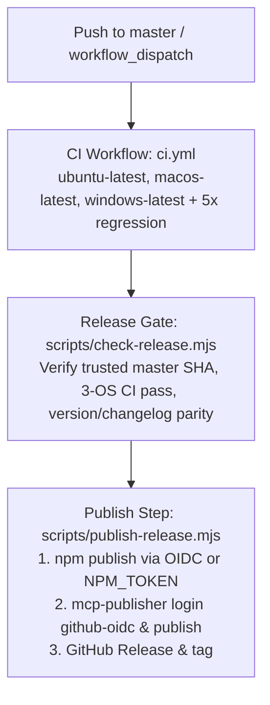

<div align="center">

# Official MCP Registry & npm Publishing Guide

**Maintainer workflow for validating and publishing `omp-worker-mcp` to npm and the Official Model Context Protocol Registry.**

<p align="center">
  English •
  <a href="registry-publishing.zh-CN.md">简体中文</a> •
  <a href="README.md">Documentation Index</a>
</p>

</div>

---

## 1. Overview & Metadata Requirements

Publishing `omp-worker-mcp` requires synchronized version and package metadata across **npm** (`https://registry.npmjs.org`) and the **Official MCP Registry** (`https://registry.modelcontextprotocol.io`).

### Key Metadata Files

- **`package.json`**:
  - `version`: Exact semantic version to be published (e.g., `0.2.0`). Read at runtime by `src/version.ts` (`readPackageVersion`) so `omp-worker-mcp --version` and MCP `serverInfo.version` always match.
  - `mcpName`: `io.github.divenire990/omp-worker-mcp` (required by the Official MCP Registry to verify npm package ownership).
  - `files`: Includes `dist`, `bin`, `server.json`, `README.md`, `LICENSE`.
- **`package-lock.json`**:
  - Top-level `version` and `packages[""].version` must match `package.json`.
- **`server.json`**:
  - Conforms to `https://static.modelcontextprotocol.io/schemas/2025-12-11/server.schema.json`.
  - Top-level `version` and `packages[0].version` must match `package.json`.
  - Declares `registryType: "npm"`, `identifier: "omp-worker-mcp"`, `version`, `stdio` transport, `runtimeHint: "npx"`, required `OMP_WORKER_OMP_COMMAND`, and optional `OMP_WORKER_ALLOWED_ROOTS` environment variable metadata. Omits `runtimeArguments` per Official MCP Registry npm conventions ([modelcontextprotocol/registry#650](https://github.com/modelcontextprotocol/registry/issues/650)) so Registry clients derive versioned `npx -y omp-worker-mcp@<version>` execution directly from `identifier` and `version` (while manual client quickstarts can continue using `npx -y omp-worker-mcp`).

---

## 2. Automated CI-Gated Publishing (`.github/workflows/publish.yml`)

Automated releases are handled by `.github/workflows/publish.yml` and gated on `.github/workflows/ci.yml`:



### Pipeline Architecture & Safety Gates

1. **Multi-OS CI Prerequisite (`.github/workflows/ci.yml`)**:
   - Runs `npm ci`, `npm test` (full unit/integration/package-install suite), and the 5x runner/MCP regression loop on `ubuntu-latest`, `macos-latest`, and `windows-latest` under Node.js 22 (`actions/checkout@v5`, `actions/setup-node@v5`).
   - Uses Node.js 24 (`package-manager-cache: false`) exclusively in the downstream `package-artifact` and `publish.yml` jobs to satisfy npm OIDC runtime requirements and package the verified build artifact (`actions/upload-artifact@v7` / `actions/download-artifact@v8`) tied to the exact tested commit SHA.
2. **Release Gate (`scripts/check-release.mjs` / `scripts/release.mjs`)**:
   - Triggered by `workflow_run` after `CI` completes on `master` (or via bounded `workflow_dispatch` recovery).
   - Rejects pull requests, forked repositories, untrusted branches, failed/cancelled CI runs, and artifact/SHA mismatches.
   - Verifies exact version alignment across `package.json`, `package-lock.json`, `server.json`, and `CHANGELOG.md`.
   - Queries npm registry state to skip ordinary non-version-bump commits cleanly, block version downgrades or tag-SHA mismatches, and allow idempotent recovery when npm succeeded previously but Official MCP Registry or GitHub Release publication still needs to complete.
3. **Publication (`scripts/publish-release.mjs`)**:
   - **npm**: Supports encrypted `NPM_TOKEN` (`NODE_AUTH_TOKEN`) authentication for immediate automated publishing and **npm OIDC Trusted Publishing** (`id-token: write`, Node.js `>= 22.14.0`, npm `>= 11.5.1`) once an OIDC trust binding is configured on npm.
   - **Official MCP Registry**: Downloads the pinned official `mcp-publisher` Go CLI release (`v1.8.2`) with SHA-256 checksum verification, runs `mcp-publisher validate`, authenticates via `mcp-publisher login github-oidc`, and runs `mcp-publisher publish` **only after** confirming the matching version is live on npm.
   - **GitHub Release**: Creates or updates the matching `v<version>` GitHub Release and tag for the verified commit without force-moving historical tags.

### Configuring npm Authentication for `.github/workflows/publish.yml`

- **Bootstrap Path — `NPM_TOKEN` Secret Fallback**:
  - When npm OIDC Trusted Publisher is not yet bound on the package, configure a publish-capable granular access token in the repository's encrypted GitHub Actions secret `NPM_TOKEN` and rotate it before expiration.
  - Credential boundary note: an npm Granular Access Token with `bypass 2FA` enabled can publish packages and authenticate `NPM_TOKEN` in GitHub Actions, but npm does **not** allow tokens to create or modify Trusted Publisher bindings. Never print or commit token values.
- **Optional OIDC Migration — npm Trusted Publisher (no long-lived token)**:
  - OIDC Trusted Publisher is **not** pre-configured by default. To migrate off `NPM_TOKEN`, a maintainer must authenticate interactively with account-level 2FA on npmjs.com (Package Settings → Trusted Publisher) or via `npm trust github --file publish.yml --repo divenire990/omp-worker-mcp` (configuring trust requires npm CLI `>= 11.15.0` and interactive account 2FA; publishing via OIDC in CI requires Node.js `>= 22.14.0` and npm `>= 11.5.1`).
---

## 3. Manual / Local Verification & Publishing Sequence

When validating a release locally or publishing manually from a maintainer workstation, use the official `mcp-publisher` Go CLI (do **not** use the deprecated `npx @modelcontextprotocol/publisher` command).

### Step 1: Build, Test & Verify Package Contents

```bash
# Run full TypeScript build and test suite (includes version and tarball install checks)
npm test

# Inspect packed tarball file list without publishing
npm pack --dry-run

# Run local release gate checks
node scripts/check-release.mjs --offline
```

Confirm that `dist/version.js` and `server.json` are present in the packed file list and that no local state directories, credentials, or private files are included.

### Step 2: Validate `server.json` with `mcp-publisher`

Install the official `mcp-publisher` CLI (`v1.8.2`, via `brew install mcp-publisher` on macOS/Linux or from [GitHub Releases](https://github.com/modelcontextprotocol/registry/releases/tag/v1.8.2)) and validate `server.json`:

```bash
mcp-publisher validate server.json
```

### Step 3: Publish to npm

```bash
npm publish --access public
```

Verify that the new version is live on `https://registry.npmjs.org/omp-worker-mcp/<version>` before publishing to the Official MCP Registry, because the registry verifies `mcpName` against the published npm tarball.

### Step 4: Authenticate & Publish to the Official MCP Registry

```bash
# Interactive maintainer login (GitHub OAuth device flow)
mcp-publisher login github

# Or in GitHub Actions with permissions.id-token: write
# mcp-publisher login github-oidc

# Publish server.json to the Official MCP Registry
mcp-publisher publish server.json
```

---

## 4. Benchmark & Telemetry Protocol

When performing benchmarks or cross-platform evaluations with `omp-worker-mcp`:

1. **Grounded Task Tracking**: Record worker job IDs, timestamp intervals (`start_time`, `finish_time`), and structured `OMP_WORKER_RESULT` payloads from the state directory (`~/.codex/state/omp-worker/jobs/`).
2. **Harness Telemetry Boundaries**: The worker captures child CLI exit codes and output streams. Do not synthesize or infer primary-harness token costs or comparative benchmark claims unless explicit telemetry data is captured from the underlying engine.
3. **Reproducibility**: Document the exact OMP model profile, OS environment, and input prompt files for all benchmark runs.

---

## 5. Release Constraints & Safety Policies

- **Release Verification Gate**: Updating release metadata (`package.json`, `package-lock.json`, `server.json`, `CHANGELOG.md`, and documentation) is validated locally and in CI before executing `git tag`, `git push`, or registry publication.
- **Accurate Version Claims**: Document feature availability by exact version requirement (e.g., `>= 0.2.0`) and verify live registry endpoints before treating a release as complete.
- **Credential & Workspace Hygiene**: Never include API keys, tokens, `.env` files, local state directories, or private workspace artifacts in git commits or npm tarballs.
