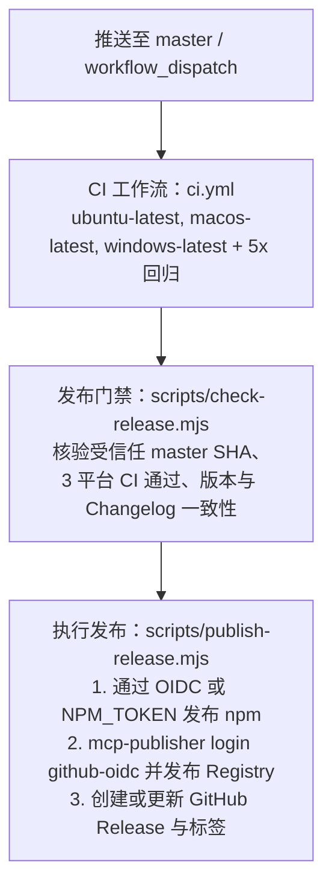

<div align="center">

# 官方 MCP Registry 与 npm 发布指南

**维护者验证与发布 `omp-worker-mcp` 至 npm 及官方 Model Context Protocol Registry 的完整流程。**

<p align="center">
  <a href="registry-publishing.md">English</a> •
  简体中文 •
  <a href="README.zh-CN.md">文档索引</a>
</p>

</div>

---

## 1. 概述与元数据要求

发布 `omp-worker-mcp` 需要在 **npm**（`https://registry.npmjs.org`）与 **Official MCP Registry**（`https://registry.modelcontextprotocol.io`）之间保持严格一致的版本与包元数据。

### 核心元数据文件

- **`package.json`**：
  - `version`：待发布的精确语义化版本号（如 `0.2.0`）。运行时由 `src/version.ts`（`readPackageVersion`）作为唯一数据源读取，确保 `omp-worker-mcp --version` 与 MCP `serverInfo.version` 始终一致。
  - `mcpName`：`io.github.divenire990/omp-worker-mcp`（官方 MCP Registry 用于核验 npm 包所有权的必填字段）。
  - `files`：包含 `dist`、`bin`、`server.json`、`README.md`、`LICENSE`。
- **`package-lock.json`**：
  - 顶层 `version` 与 `packages[""].version` 必须与 `package.json` 保持一致。
- **`server.json`**：
  - 遵循官方 Schema `https://static.modelcontextprotocol.io/schemas/2025-12-11/server.schema.json`。
  - 顶层 `version` 与 `packages[0].version` 必须与 `package.json` 保持一致。
  - 声明 `registryType: "npm"`、`identifier: "omp-worker-mcp"`、`version`、`stdio` 传输、`runtimeHint: "npx"`、必填环境变量 `OMP_WORKER_OMP_COMMAND` 以及可选环境变量 `OMP_WORKER_ALLOWED_ROOTS`。遵循官方 MCP Registry 的 npm 包规范（[modelcontextprotocol/registry#650](https://github.com/modelcontextprotocol/registry/issues/650)）省略 `runtimeArguments`，由客户端根据 `identifier` 与 `version` 自动推导版本化的 `npx -y omp-worker-mcp@<version>` 启动命令（用户手动配置客户端时仍可直接使用 `npx -y omp-worker-mcp`）。

---

## 2. CI 门控自动化发布（`.github/workflows/publish.yml`）

自动化发布由 `.github/workflows/publish.yml` 执行，并受 `.github/workflows/ci.yml` 严格门控：



### 流水线架构与安全门禁

1. **三平台 CI 前置门禁（`.github/workflows/ci.yml`）**：
   - 在 Node.js 22（`actions/checkout@v5`、`actions/setup-node@v5`）下，于 `ubuntu-latest`、`macos-latest` 和 `windows-latest` 全部运行 `npm ci`、`npm test`（含版本一致性与隔离打包安装测试）以及 5 次 Runner/MCP 回归循环。
   - 仅在后续独立的产物打包（`package-artifact`）与发布（`publish.yml`）作业中使用 Node.js 24（显式设置 `package-manager-cache: false` 禁用包管理器自动缓存），以满足 npm OIDC 运行时要求并打包上传与被测 commit SHA 绑定的构建产物（`actions/upload-artifact@v7` / `actions/download-artifact@v8`）。
2. **发布门禁检查（`scripts/check-release.mjs` / `scripts/release.mjs`）**：
   - 在 `CI` 于 `master` 分支完成后通过 `workflow_run` 触发（或通过受控的 `workflow_dispatch` 手动恢复触发）。
   - 拒绝 Pull Request、Fork 仓库、非受信任分支、未通过的 CI 运行以及产物/SHA 不匹配的情况。
   - 校验 `package.json`、`package-lock.json`、`server.json` 与 `CHANGELOG.md` 的版本一致性。
   - 查询 npm 线上状态：对未升级版本号的普通文档/代码提交安全跳过发布；拒绝版本降级或标签 SHA 冲突；当 npm 已发布成功但 MCP Registry 或 GitHub Release 尚未完成时，支持幂等重试恢复而不会重复覆盖 npm。
3. **发布执行（`scripts/publish-release.mjs`）**：
   - **npm 发布**：支持使用加密的 GitHub Actions 密钥 `NPM_TOKEN`（`NODE_AUTH_TOKEN`）立即执行自动化发布，并在未来完成 npm 端 OIDC 信任绑定后支持 **npm OIDC Trusted Publishing**（需 `id-token: write`、Node.js `>= 22.14.0`、npm `>= 11.5.1`）。
   - **Official MCP Registry 发布**：下载固定版本的官方 `mcp-publisher` Go CLI（`v1.8.2`）并校验 SHA-256 摘要，执行 `mcp-publisher validate`，通过 `mcp-publisher login github-oidc` 认证，并在**确认对应 npm 版本已上线后**执行 `mcp-publisher publish`。
   - **GitHub Release**：为通过验证的发布提交创建或更新对应的 `v<version>` GitHub Release 与标签，绝不强制移动历史标签。

### 为 `.github/workflows/publish.yml` 配置 npm 认证

- **引导方式 — `NPM_TOKEN` 密钥回退（Bootstrap）**：
  - 在尚未于 npm 端绑定 OIDC Trusted Publisher 时，可在 GitHub 仓库的加密 Actions Secrets 中配置具备发布权限的颗粒度访问令牌（`NPM_TOKEN`），并在令牌到期前定期轮换。
  - 凭证权限边界说明：开启了 `bypass 2FA` 的颗粒度访问令牌（Granular Access Token）可用于直接发布包或作为 GitHub Actions 的 `NPM_TOKEN` 密钥，但根据 npm 官方限制，此类令牌**无法**用于创建或修改 Trusted Publisher 绑定。严禁在日志、命令行参数或仓库文件中暴露 Token 明文。
- **可选的 OIDC 迁移方式 — npm Trusted Publisher（免长期 Token）**：
  - OIDC Trusted Publisher 默认**未**预绑定。若需迁移至免长期密钥的 OIDC 发布，维护者须使用开启交互式账户级 2FA 的会话在 npmjs.com 网页端（Package Settings → Trusted Publisher）或通过 `npm trust github --file publish.yml --repo divenire990/omp-worker-mcp` 完成绑定（执行 `npm trust` 需 npm CLI `>= 11.15.0` 及交互式账户 2FA；而在 CI 中执行 OIDC 发布需 Node.js `>= 22.14.0` 与 npm `>= 11.5.1`）。
---

## 3. 本地校验与手动发布步骤

在维护者本机验证发布元数据或手动执行发布时，请使用官方 `mcp-publisher` Go CLI（**不要**使用已废弃的 `npx @modelcontextprotocol/publisher` 命令）。

### 第 1 步：构建、测试与打包清单核验

```bash
# 运行完整 TypeScript 构建与自动化测试套件（含版本与隔离安装校验）
npm test

# 干跑检查 npm 打包文件列表
npm pack --dry-run

# 运行本地离线发布门禁检查
node scripts/check-release.mjs --offline
```

确认打包清单包含 `dist/version.js` 与 `server.json`，且不包含任何本地状态目录、凭证或私有文件。

### 第 2 步：使用 `mcp-publisher` 校验 `server.json`

安装官方 `mcp-publisher` CLI（`v1.8.2`，macOS/Linux 可通过 `brew install mcp-publisher` 安装，或从 [GitHub Releases](https://github.com/modelcontextprotocol/registry/releases/tag/v1.8.2) 下载对应平台二进制文件），然后执行本地校验：

```bash
mcp-publisher validate server.json
```

### 第 3 步：发布至 npm

```bash
npm publish --access public
```

在继续发布至官方 MCP Registry 之前，请先确认新版本已在 `https://registry.npmjs.org/omp-worker-mcp/<version>` 生效（MCP Registry 会拉取已发布的 npm 包核验 `mcpName`）。

### 第 4 步：登录并发布至官方 MCP Registry

```bash
# 维护者交互式登录（GitHub OAuth Device Flow）
mcp-publisher login github

# 若在开启 permissions.id-token: write 的 GitHub Actions 中运行：
# mcp-publisher login github-oidc

# 提交 server.json 至官方 MCP Registry
mcp-publisher publish server.json
```

---

## 4. 基准测试与评估协议

在进行多平台对比或基准测试（Benchmark）时，遵循以下规范：

1. **客观数据记录**：记录任务分发时间戳、执行耗时、提示词长度以及状态目录（`~/.codex/state/omp-worker/jobs/`）中持久化的 `OMP_WORKER_RESULT` 结构体。
2. **遥测边界清晰**：Worker 准确记录子进程退出码与标准输出流。严禁在缺乏主框架真实遥测数据的情况下伪造对比成本或 Token 数据。
3. **环境可复现性**：完整记录测试使用的 OMP 模型 Profile、操作系统版本与测试提示词。

---

## 5. 发布边界与安全准则

- **发布门禁核验**：更新发布元数据（`package.json`、`package-lock.json`、`server.json`、`CHANGELOG.md` 与文档）后，须先通过本地与 CI 门禁校验，再执行标签推送与外部注册表发布。
- **准确标注版本要求**：在文档中按精确版本号（如 `>= 0.2.0`）说明特性可用性，并在注册表索引生效后核验线上状态。
- **凭证与工作区卫生**：严禁将 API Key、Token、`.env` 文件、本地状态目录或私有工作区文件纳入 Git 提交或 npm 发布包。
